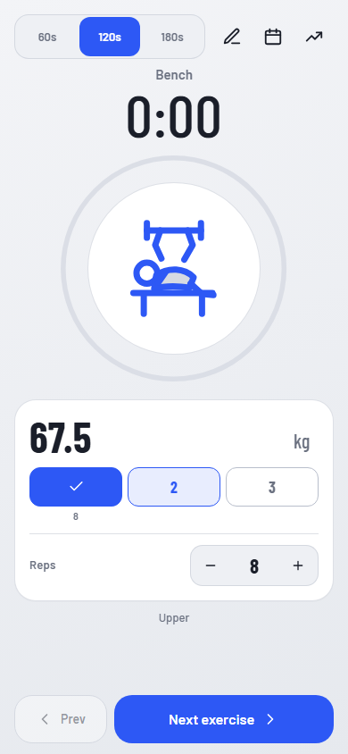

# Workout Tracker

A minimalist, offline workout PWA for the gym. Start a session in one tap, log
sets and reps with an automatic rest timer, and see your training fill in on a
calendar and progress card. Built as plain HTML, CSS and JavaScript — no build
step, no framework and no runtime dependencies.



## What it does

- **Two starting programs on first run** — Upper and Lower — plus a one-time
  import of seven November 2026 sessions with their barbell weights. No demo
  sessions are generated.
- **One-tap workout start** from the workout screen or directly from the
  program editor.
- **A rest timer that counts up from 0:00 to 60, 120 or 180 seconds**, driven by
  timestamps rather than interval ticks. Tap to start, pause or resume; double
  tap to reset. The ring and timer turn green and vibrate when the break ends.
- **Set logging** with weight, reps, automatic timestamps and a generated
  session history.
- **An autosaved active workout** that survives reloads and app restarts.
- **A Monday-first calendar** with prominent trained days, per-day sessions and
  in-progress workouts counted as today.
- **Per-day notes** below the selected day, autosaved as you type and folded
  into a compact card like a session.
- **Progress sparklines** using best-set weight (or total reps for body-weight
  work) with a delta from the first session.
- **Inline exercise editing** on saved calendar sessions and Progress: rename an
  exercise everywhere or adjust that session's set weights without leaving the
  page.
- **Automatic dark mode**, reduced-motion support, keyboard reordering and
  pointer drag reordering.
- **Installable and offline-capable** through a web app manifest and service
  worker.

## Install on Android (5 steps)

1. Open the deployed GitHub Pages URL in Chrome on Android. The site must be
   served over HTTPS (GitHub Pages provides this).
2. Wait for the first load to finish while online so the app shell, icons and
   Google Fonts are cached.
3. Open Chrome's three-dot menu and choose **Install app** (or **Add to Home
   screen** on older Chrome versions).
4. Confirm the installation, then launch **Workout** from the Android home
   screen or app drawer.
5. Choose **Start Upper workout** — or open a program and press **Start
   workout** — to begin your first session.

The app now runs from its own standalone window. There are no accounts and no
permissions to grant.

## Update the app and bump the cache

The service worker precaches the app shell. When shipping a change, the cache
name must change so installed copies receive the new files:

1. Make and test your changes to the static files.
2. In `sw.js`, change **only this line** to a new unique value, for example
   `const CACHE_VERSION = "wt-v5";` → `const CACHE_VERSION = "wt-v6";`
3. Commit and push to `main`, and let GitHub Pages finish deploying.
4. Open the installed app twice with internet available: the first launch
   checks for and installs the new worker, the second launch serves the newly
   cached shell.
5. Optionally verify the new version in Chrome DevTools → Application →
   Service Workers / Cache Storage (`workout-tracker-shell-wt-v6`).

Bumping the version is enough: the worker deletes superseded
`workout-tracker-*` caches during activation and claims open clients. Because of
that activation flow, Chrome can sometimes require closing and reopening the
app twice after an update.

## Run and verify locally

The app has no build step. Because service workers require a secure context,
serve the directory from localhost or HTTPS rather than opening the HTML file
directly:

```sh
python -m http.server 4173 --bind 127.0.0.1
```

Then open `http://127.0.0.1:4173/`.

Automated browser checks live in `tests/` and use Playwright with headless
Chromium. They are development-only and do not ship as app runtime
dependencies.

```sh
cd tests
npm install
npx playwright install chromium
cd ..
node tests/verify.cjs
node tests/capture-screenshots.cjs
```

`tests/verify.cjs` covers first-run seeding and the one-time history import,
the one-time barbell-weight migration, editor changes, pointer and keyboard
reordering, workout logging, timer states, calendar and progress behaviour,
inline exercise editing, offline loading, reload persistence, the 360 × 740
layout, icons, the manifest and service worker registration.
`tests/capture-screenshots.cjs` writes the six screens in both colour schemes to
`tests/screenshots/`.

## Files

| Path | Purpose |
| --- | --- |
| `index.html` | App shell, font loading, manifest and theme colours |
| `styles.css` | Design tokens, light/dark themes, layout and components |
| `app.js` | Storage, routing, illustrations and all screen behaviour |
| `sw.js` | Versioned app-shell cache, font stale-while-revalidate |
| `manifest.webmanifest` | PWA name, display, orientation and icons |
| `icons/` | Generated 192, 512 and maskable 512 PNGs |
| `scripts/generate_icons.py` | Reproducible icon generation with Pillow |
| `tests/` | Playwright verification and reviewed screenshots |
| `TODO.md` | Milestone checklist |
| `ASSUMPTIONS.md` | Decisions made where the brief leaves room |

All app URLs are relative (`./`) so the same files work at a GitHub Pages
sub-path. Data is stored in `localStorage` under the `wt.v1.` prefix —
`wt.v1.programs`, `wt.v1.sessions`, `wt.v1.active` and `wt.v1.settings` — plus
the per-day `notes` key, which holds `{ "YYYY-MM-DD": "text" }`. The one-time
`importV1` and `barFixV1` flags record that the historical merge and the
barbell-weight migration have completed.

## Known limitations

- Data is local to this browser and device. It is lost if site data is cleared
  or the app is uninstalled.
- There is no sync between devices or browsers.
- Rest-timer vibration cannot fire while the screen is off or the app is in the
  background (the Screen Wake Lock mitigates this while a workout is active).
- Vibration works on Android Chrome only.
- The first load needs internet access for the Google Fonts files; after that
  the system font fallbacks keep the app usable offline.
- A new version can require closing and reopening the app twice before the new
  version is active.
